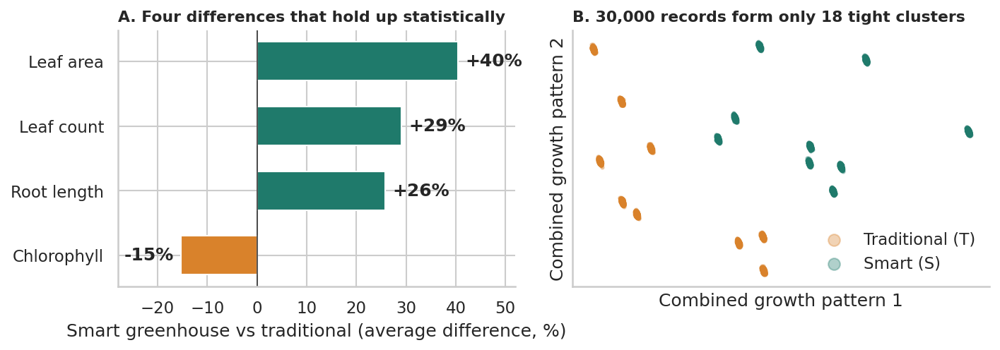

# Does a Smart Greenhouse Change Plant Growth?

A data analysis and machine-learning project on the *Advanced IoT Agriculture 2024* dataset (30,000 plant records, 12 measurements). It asks whether plants grown in a smart (IoT-controlled) greenhouse differ from plants in a traditional one, and, just as importantly, **whether the near-perfect model accuracy this dataset produces can be trusted**.



## Key findings

- **Four differences hold up statistically.** Smart-greenhouse plants had about **40% larger leaf area, 29% more leaves and 26% longer roots**, and about **15% lower chlorophyll**. All four stay significant after Holm correction across 12 traits. Root weight is also about two-thirds higher in the smart greenhouse, but that result is suggestive rather than conclusive.
- **The 30,000 rows are really 18 clusters.** Each row belongs to one of 6 classes and one of 3 replicates, and that combination explains **99.6–100%** of the variance in every trait. Rows inside a cluster are near-copies, so the effective sample size is 18, not 30,000. The greenhouse comparison is therefore tested on the 18 group means (9 vs 9).
- **"100% accuracy" does not survive a realistic test.** Logistic regression, random forest and gradient boosting all score about 100% under standard cross-validation, and even a single trait is enough. Holding out an entire replicate drops six-class accuracy to **33–67%**, while the simpler smart-vs-traditional task stays at 100% for the random forest. 99–100% of the six-class errors stay inside the same greenhouse.
- **The data is very likely simulated or augmented**, so conclusions describe this dataset and not real field results.

| Validation method | Six-class accuracy | Smart vs traditional |
|---|---|---|
| Standard random 5-fold CV | about 100% | about 100% |
| Leave one replicate out | 33–67% | 100% (random forest) |

## What I changed compared with a typical first pass

| Typical first pass | This project |
|---|---|
| Treat all 30,000 rows as independent plants | Detect the 18-cluster structure and test at the group level |
| Report 100% accuracy as success | Treat it as a warning sign and validate by holding out whole replicates |
| p-values on 30,000 rows (all ≈ 0) | Effect sizes, Holm-corrected tests on group means |
| Shapiro-Wilk normality test on 30,000 rows | Skewness and visual checks, rank-based tests |
| Label-encode the replicate column as a model feature | Treat it as a batch label and keep it out of the models |
| Radar chart on min-max scaled means | Heatmap of z-scored class means |

## Repository structure

```
iot-greenhouse-analysis/
├── README.md
├── requirements.txt
├── data/
│   └── README.md              # how to download the dataset (CSV not included)
├── notebooks/
│   └── iot_greenhouse_analysis.ipynb
├── figures/                   # charts exported by the notebook
└── report/
    └── Smart_Greenhouse_Project_Report.docx   # 2-page plain-language summary
```

## Notebook contents

| Section | What it covers |
|---|---|
| 1–3 | Setup, loading, cleaning, data dictionary |
| 4 | Data quality checks, outliers, evidence of simulated data, the 18-cluster finding |
| 5 | Exploratory analysis: distributions, class comparison, correlations |
| 6 | Smart vs traditional comparison (descriptive and cell-level inference) |
| 7 | Variance explained by greenhouse, group and replicate; post-hoc tests |
| 8 | PCA |
| 9 | Models, minimal-feature test, leave-one-replicate-out validation, feature importance |
| 10–12 | Conclusions, limitations, next steps |

## How to run

```bash
# 1. Clone and enter the repo
git clone https://github.com/dhappo/iot-greenhouse-analysis.git
cd iot-greenhouse-analysis

# 2. Create an environment and install dependencies
python -m venv .venv
source .venv/bin/activate        # Windows: .venv\Scripts\activate
pip install -r requirements.txt

# 3. Download the dataset (see data/README.md) into data/

# 4. Open the notebook
jupyter notebook notebooks/iot_greenhouse_analysis.ipynb
```

The notebook uses relative paths and runs top to bottom. Charts are saved to `figures/`.

## Dataset and attribution

- **Dataset:** *Advanced IoT Agriculture 2024*, Kaggle, uploaded by `wisam1985` — <https://www.kaggle.com/datasets/wisam1985/advanced-iot-agriculture-2024>
- **Origin:** master's thesis research by Mohammed Ismail Lifta (2023–2024), Department of Computer Science, College of Computer Science and Mathematics, Tikrit University, Iraq, supervised by Asst. Prof. Wisam Dawood Abdullah. Data were collected in an agriculture lab from plants grown in an IoT greenhouse and a traditional greenhouse.
- The dataset owner asks for proper attribution in any publication and asks that the data is not altered. This project never modifies the raw file and does not redistribute it.

## Limitations

- **Likely simulated or augmented data.** Results describe this dataset, not real plants in the field.
- **Labels are my interpretation.** The source does not define the class labels. I read S as smart (IoT) and T as traditional from the study context; the meaning of A/B/C and of the `Random` column (treated here as a replicate label) is not documented.
- **Small effective sample.** Only 18 groups (9 per greenhouse), and no units, dates or plant IDs, limit what can be concluded and why some large effects are not significant.
- **Redundant predictors.** Several traits are strongly correlated (for example root diameter and root wet weight, r = 0.96), so feature-importance rankings should be read as "overlapping", not as independent contributions.

## Possible next steps

- Confirm the label definitions with the dataset author or the thesis.
- Repeat the analysis on a genuinely measured greenhouse dataset.
- Build a small interactive app (for example Streamlit) to explore trait differences by class.

## Author

**Abdulsobur Abiola Oladapo (Dapo)** — data analysis and machine learning  
Portfolio: <https://abdulsobur-oladapo.lovable.app>
